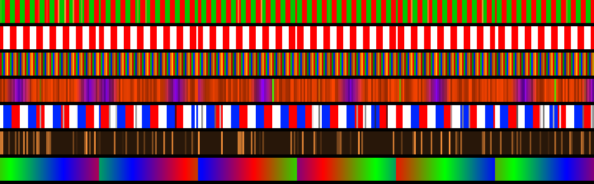

# OpenPix

Open replacement firmware for the **HolidayCoro AlphaPix Evolution** pixel controller
(CPU board #951-11, GigaDevice GD32F450) with the 16-port SPI expansion board (#951-21).

> Status: **v0.1, untested on hardware.** Flashing custom firmware can brick the board.
> Keep an ST-Link (SWD on header J2) and the original HolidayCoro `.bin` handy for recovery.

## Why

The stock web page allows only one logged-in user, and saving any setting reboots the
controller, which often doesn't come back on the network without a power cycle. OpenPix:

- saves settings instantly, **no reboot**
- no login lock (multiple browsers/phones fine)
- mobile-friendly UI with live status, overlap warnings for universes, test patterns
- receives **sACN (E1.31)**, **Art-Net** and **DDP** at the same time
- never hangs waiting for the network: it retries and the watchdog recovers crashes
- firmware updates are staged and verified **before** anything is overwritten, and you can
  upload the stock HolidayCoro `.bin` to go back

## Built-in holiday effects

Christmas, Candy cane, Classic multicolor, Halloween, 4th of July, Warm twinkle, Rainbow.
Pick one on the web page; it is saved and plays whenever no show data is arriving
(xLights/FPP data takes over automatically, the effect resumes 3 s after it stops).



## Install

1. Open the stock web page, go to Firmware Update, and upload `openpix.bin`.
2. Power-cycle the controller if it doesn't come back by itself (stock reboot bug).
3. Browse to the IP on the OLED screen (default **10.0.0.80**).

Hold the two buttons used for the stock "load defaults" (PA4 + PA11) at power-up to reset
OpenPix settings to defaults.

To go back to stock: Firmware card → upload the HolidayCoro `.bin`.

## Defaults

- Static IP 10.0.0.80 / 255.255.255.0, gateway 10.0.0.1
- Outputs 1–16: 340 pixels, GRB, universes 1, 3, 5 … 31 (510 channels per universe)

## Build

```
sudo apt install gcc-arm-none-eabi libnewlib-arm-none-eabi python3
tools/get-deps.sh
make
```

Output: `build/openpix.bin` (linked at 0x08010000, after the HolidayCoro bootloader).

## Hardware notes (from analysis of stock firmware V4.07)

| Function | Pins |
|---|---|
| Ethernet RMII (no MDIO, 100M full duplex forced) | PA1, PA7, PB11, PB12, PB13, PC4, PC5 |
| Pixel data, expansion port 1 | PB0–PB7, PC8–PC15 |
| Pixel data, ports 2/3 | PE0–PE15, PD0–PD15 |
| Pixel clock | PB15 |
| OLED SSD1306 (bit-banged I2C, 0x78) | PA8 SCL, PC7 SDA |
| Buttons (active low) | PA4, PA5, PA10, PA11, PA12 |
| SWD | PA13, PA14 (never touched) |

Flash map: bootloader 0x08000000–0x0800BFFF and factory ID/stock settings
0x0800C000–0x0800FFFF are never written. App 0x08010000, update staging 0x08080000,
OpenPix settings 0x080E0000.

The output-to-pin order inside each port is a best guess; use **Test → Identify outputs**
and adjust the **Line** column if needed.

## License

OpenPix source: MIT. Font: Adafruit GFX 5x7 (BSD, see `tools/FONT_LICENSE.txt`).
lwIP and CMSIS are fetched separately under their own licenses.
This project contains no HolidayCoro code.
